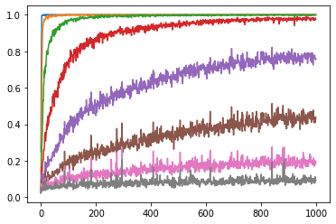
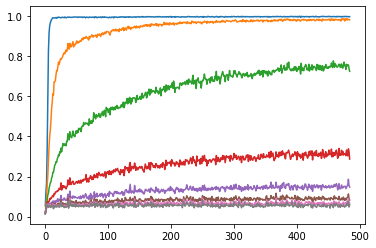
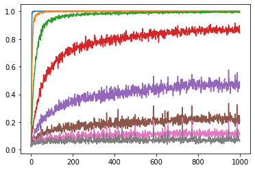
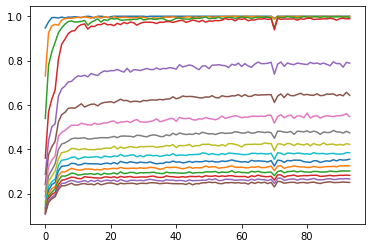

<p align="right"><a href="README.md">English</a> · <a href="README.zh-CN.md">简体中文</a></p>

<p align="center">
  
</p>

<h1 align="center">seq_autoenc</h1>

<p align="center"><strong>面向中文新闻与 Python 源码的多尺度序列自编码器。</strong></p>

<p align="center">
  大多数自编码器把整段序列压成一个向量。<br>
  这里让同一个卷积编解码器在每一个下采样尺度上同时重建整段序列。
</p>

<p align="center">
  配套的 n-gram 与后缀数组基线，用来回答一个更基本的问题：这份数据本身究竟有多可预测。
</p>

---

<p align="center">
  
</p>

<p align="center">
  <sub>512 词元训练窗口下，各尺度的 top-1 准确率。图来自 <a href="01_multiscale_autoencoder.ipynb"><code>01_multiscale_autoencoder.ipynb</code></a>；原始图表没有坐标轴标签，也没有记录训练配置。</sub>
</p>

## 它做什么

核心模块是 `EncDec`。它不把序列压进单个瓶颈，而是让编码器每次经过一个 `MaxPool1d(2)` 向下走一层；每层都有一个小预测头输出整段序列，解码器再把该层的预测上采样回原始长度。所有层的 logits 拼接在一起，`cross_entropy` **同时作用于每一个尺度**。

于是自编码器变成了一座由粗到细的重建金字塔：最深层上下文最多、位置最少；最浅层几乎就是一个局部 n-gram 模型。保存下来的“准确率—尺度”曲线就是这件事的结果。

围绕核心还有三条支线：

- **切分方式** —— 字符级（7,622 类）与字节级（256 类）的对比。
- **解码器形态** —— 并行的多尺度解码器，与显式自回归的 GRU 解码器 `DecR` 的对比。
- **数据可预测性** —— k 阶条件熵、最高频延续 n-gram、上下文唯一性统计，以及后缀数组下一字符预测器。

## 快速开始

这是一个 notebook 归档，不是一个可安装的包——没有构建步骤，也不在 PyPI 上。

```bash
git clone https://github.com/ZisIsNotZis/seq_autoenc.git
cd seq_autoenc
pip install torch numpy matplotlib tqdm numba jupyterlab
jupyter lab
```

然后打开 **[`01_multiscale_autoencoder.ipynb`](01_multiscale_autoencoder.ipynb)**。它是最完整的入口：整条流水线，以及四张保存下来的结果图。

> **运行之前：** 仓库里没有语料。除非你提供 `inews.B` / `inews.7622` 或 `../nlpdat/py/all.B`，训练 notebook 会在第一次 `np.memmap` 处停下。详见[数据](#数据)。分析类 notebook 也需要同一批派生二进制文件。

## 目前能做什么

- **在每个尺度上重建。** 一个卷积编解码器在每一层下采样后预测整段序列，所有层共享同一个 `cross_entropy` 监督。
- **对比两套词表。** 中文新闻可以用 256 类字节词表，也可以用 7,622 类字符词表；Python 源码则使用 90 类词表。
- **对比解码器形态。** 并行的多尺度 `EncDec`、按时间步展开的 `DecR`、以及固定向量 `Enc` 的下一词元基线。
- **不只测模型，也测数据。** k 阶条件熵、上下文唯一性比例、多数延续 n-gram 表，以及能贪心生成文本的后缀数组预测器。
- **在 notebook 里实时看每个尺度。** `Log` 辅助类会在 Jupyter 中不断重绘各尺度的运行准确率。
- **观察学到的 n-gram 阶数。** `EmbeddingAuto` 是一个带可学习指数位置衰减的 `EmbeddingBag`；notebook 会打印归一化后的权重，用来看有效上下文长度。

## Notebook 地图

| Notebook | 内容 |
| --- | --- |
| [`01_multiscale_autoencoder.ipynb`](01_multiscale_autoencoder.ipynb) | **主入口。** 数据加载、`toH`/`toB`、完整容器集、256 字节多尺度训练、`DecR` 对比、7,622 字符变体、四张结果图。 |
| [`02_multiscale_short_windows.ipynb`](02_multiscale_short_windows.ipynb) | 主模型的短窗口（8 / 16 词元）版本。 |
| [`03_scale_decomposition.ipynb`](03_scale_decomposition.ipynb) | 32 词元模型，比较保留不同层数时的表现。 |
| [`04_window_length_sweep.ipynb`](04_window_length_sweep.ipynb) | 窗口长度 / 深度扫描（256、16、9），附固定向量 `Enc` 对比。 |
| [`05_fixed_vector_encoder.ipynb`](05_fixed_vector_encoder.ipynb) | `inews.7622` 上的固定向量 `Enc` 下一词元模型，并用 n-gram 熵做对照。 |
| [`06_learned_ngram_embedding.ipynb`](06_learned_ngram_embedding.ipynb) | `EmbeddingAuto` 可学习 n-gram 嵌入加线性头，比较几种宽度。 |
| [`07_embedding_head_variants.ipynb`](07_embedding_head_variants.ipynb) | `EmbeddingAuto` 的几种头部：原始、Softmax、LogSoftmax、ReLU、Affine；并打印学到的衰减权重。 |
| [`08_python_source_encoder.ipynb`](08_python_source_encoder.ipynb) | Python 源码（90 类词表）上的固定向量 `Enc` 下一词元模型，k = 64 / 128 / 512。 |
| [`09_conditional_entropy.ipynb`](09_conditional_entropy.ipynb) | 中文文本的 k 阶条件熵，k = 1..8，单位为比特/字符。 |
| [`10_context_uniqueness.ipynb`](10_context_uniqueness.ipynb) | n = 4、8、12 时的上下文唯一性比例，含 `numba` 加速。 |
| [`11_ngram_continuation.ipynb`](11_ngram_continuation.ipynb) | n = 2..5 的最高频延续表，字符级与字节级各一套。 |
| [`12_suffix_array_predictor.ipynb`](12_suffix_array_predictor.ipynb) | 后缀数组下一字符预测器，以及贪心文本生成。 |

## 保存下来的结果

原始训练只留下四张曲线。它们嵌在主 notebook 里，这里抽出成图片。坐标轴没有标签，数值日志也已经丢失，所以请把它们当作趋势来看，而不是可复现的基准。

| 窗口 64 | 窗口 256 | 窗口 512 |
| :---: | :---: | :---: |
|  |  |  |

<p align="center">
  
</p>

<p align="center"><sub><code>DecR</code> 的准确率随解码位置变化：前几个字符很强，之后逐渐走平。</sub></p>

## 架构

这些容器在每个 notebook 里就地重新定义，没有共享模块。以下是主 notebook 中的核心集合：

| 名称 | 作用 |
| --- | --- |
| `F` | 把一个函数包装成 `Module`（`s.f(x)` 或 `s.f(x, s.a)`）。 |
| `Enc` | 反复运行 `Sequential` 直到长度轴为 1，返回 `x[..., 0]`——固定长度编码器。 |
| `EncDec(*a, n=0)` | **核心。** 下采样一层、在该层预测、再上采样回全长；循环后拼接。`n` 用来提前停止递归。 |
| `Add` | 对分支输出求和的 `Sequential`：`sum((s(x) for s in s[1:]), s[0](x))`。 |
| `Res` | 带残差相加的 `Sequential`。 |
| `Rep(n, *a)` | 把同一组层重复应用 `n` 次。 |
| `Mean(Add)` | 分支求平均的 `Add`。 |
| `DecR(gru, head)` | 自回归解码器：用 `linspace(0, 1, i)` 时间嵌入驱动 `GRU(1, k)`，每一步生成长度为 `i` 的重建。 |
| `EmbeddingAuto(EmbeddingBag)` | 静态可学习 n-gram 嵌入：`mode='sum'`，把可学习指数衰减 `l = 0.5 ** arange(l-1, -1, -1)` 作为 `per_sample_weights` 传入。 |
| `Affine`、`Log` | 逐通道缩放加偏置；以及一个用 `matplotlib` 实时重绘指标的日志器。 |

`EncDec` 全文：

```python
class EncDec(Sequential):
    def forward(s, x):
        Y = []
        for i in range(int(np.log2(x.size(2)))):
            x = s[0](x)                          # 再下采样一层
            y = s[1](x)                          # 在该层预测整段序列
            for i in range(i + 1):
                y = s[2](y)                      # 上采样回原始长度
            Y.append(y)
        return torch.cat(Y)                      # 每个尺度一块 logits
```

主模型：

```python
Embedding(256, k) → transpose(1, 2) → EncDec(...) → Conv1d(k, k, 1)
→ BatchNorm1d → SiLU → Conv1d(k, 256, 1)
```

训练时按尺度切开拼接后的 logits，每一块都对同一个目标做监督：

```python
x = m(y).unflatten(0, (int(np.log2(a.size(1))), -1))
functional.cross_entropy(x.transpose(1, 2),
                         y.expand(len(x), -1, -1)).backward()
```

优化器是 Adam + `OneCycleLR`，指标是每个尺度的 top-1 准确率。各 notebook 使用的窗口长度从 8 到 2,048 词元不等。

把层折叠进 `Sequential` 的写法与作者的 [cznn](https://github.com/ZisIsNotZis/cznn) 同源，但两边没有代码依赖。

## 数据

两份语料都来自作者的私有上级目录。**原始文本和派生二进制文件都没有放进这个仓库。**

| 语料 | 来源 | 派生文件 |
| --- | --- | --- |
| 中文新闻（`inews`） | `../nlpdat/inews/{train,dev,test}.txt`，以 `_!_` 分隔 | `inews.U`（原始 UTF-16 单元）、`inews.7622`（字符词表）、`inews.B`（CJK，取前 256 个字节） |
| Python 源码 | `../nlpdat/py/{py,pyp,ipynb,ipynbp}.txt` | `all.B`（字节级）、`all.90`（90 类词表）；`all.sort.I` 是中间文件 |

`inews` 按 UTF-16 码元读取：

```python
def inews(a="../nlpdat/inews/dev.txt"):
    a = np.loadtxt(a, "U", None, "_!_", usecols=(2, 3), encoding="utf-8")
    a = a.view("I").view("2H")[..., 0]
    a[:, -1] = ord("。")
    return a[a.astype("?")]
```

`01_multiscale_autoencoder.ipynb` 可以从原始文本重新生成 `inews.U`、`inews.7622` 和 `inews.B`。`all.B` / `all.90` 则无法重建：它们的源文本已经不在仓库里了。

## 开发

没有构建、没有测试套件、也没有 CI。notebook 就是事实来源；每个 notebook 都刻意重新定义自己用到的容器，以便单独阅读。

- **环境：** Python 3、PyTorch、NumPy、matplotlib、tqdm、numba、JupyterLab。`pip install torch numpy matplotlib tqdm numba jupyterlab`。
- **仅限 CUDA：** 多数训练 notebook 调用 `torch.set_default_tensor_type(torch.cuda.FloatTensor)`，没有 `.cpu()` 回退。在 CPU 机器上删掉这一行。
- **数据路径：** 把派生二进制放到 notebook 期望的位置，或者直接改 `np.memmap` 的路径。不要提交语料、检查点或生成的二进制文件——`.gitignore` 已覆盖 `*.pk`、`*.pt`、`*.npy` 以及 `inews.*` / `all.*` 系列。
- **在临时目录里运行：** notebook 会往自己的工作目录写生成的二进制，也会写到仓库外的 `../nlpdat/py/all.sort.I`。
- **提交之前：** 清空 notebook 输出。四张结果图已经抽取到 [`assets/results/`](assets/results/)，新工作不必再保留体积很大的内嵌附件。

## 参与贡献

这是一个研究归档，不是持续维护的库，但欢迎聚焦的修复。简短说明见 [CONTRIBUTING.md](CONTRIBUTING.md)：issue 请带上清晰的复现步骤，pull request 尽量小，不要加入私有语料或模型检查点。

适合的贡献方向：可复现性说明、更清楚的数据准备步骤、CPU 路径，以及把重复出现的容器抽成可导入模块。

## 路线图

**已实现**

- 多尺度 `EncDec`，每个尺度都接受重建监督。
- 中文新闻的字节级（256）与字符级（7,622）切分。
- `DecR` 自回归解码器，以及固定向量 `Enc` 的下一词元基线。
- `EmbeddingAuto` 可学习 n-gram 嵌入与几种头部变体。
- k 阶条件熵、上下文唯一性统计、多数延续 n-gram、后缀数组预测器。
- 四张各尺度准确率曲线，已抽取到 `assets/results/`。

**计划中**

- 把 `F`、`Enc`、`EncDec`、`Add`、`Res`、`Rep`、`Mean`、`DecR`、`EmbeddingAuto` 抽成一个可导入的 `seq_autoenc` 包。
- 写清楚语料准备流程，能从私有原始文本复现 `inews.B`、`inews.7622`、`inews.U`。
- 增加 CPU / MPS 回退，以及一个不依赖语料的小型合成数据冒烟测试。
- 在每张保存的图旁边记录训练配置和数值日志。
- 写一篇简短的技术说明，让四张曲线变成结论，而不只是产物。

### 可以走向哪里

真正值得保留的想法是“每个尺度都监督”：让同一个卷积栈同时在多个时间分辨率上有用。只要补上可复现的语料准备流程和一个小型可导入模块，它就可以成为一个紧凑的层级序列模型试验台；仓库里已有的 n-gram 与后缀数组基线，则会让这个试验台保持诚实。

## 状态与限制

这是一个 2026 年的个人研究归档，公开是为了留存记录、方便阅读；它不再维护，也无法按当前仓库直接复现。

- 语料缺失，训练 notebook 无法端到端运行。
- 多数 notebook 只能在 CUDA 上跑。
- 结果只剩四张图，没有数值日志，也没有检查点。
- 图表坐标轴没有标签，训练配置也没有记录。
- 没有打包、CLI、测试套件或 CI。

更完整的证据与边界见 [`docs/project-status.md`](docs/project-status.md)。

## 许可证

[GNU Affero General Public License v3.0](LICENSE)（AGPL-3.0-only）。
